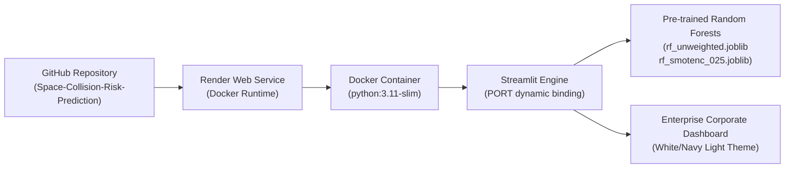

# Satellite Conjunction Risk Screening Dashboard

[](https://render.com)
[](https://www.docker.com)
[](https://streamlit.io)
[](https://python.org)
[](https://scikit-learn.org)

An enterprise-grade, machine-learning-powered web dashboard for screening and classifying satellite conjunction events using standard Conjunction Data Messages (CDMs). The system is purpose-built to operate in the critical early operational window **2.0 to 2.9 days before Time of Closest Approach (TCA)**.

The application is deployed exclusively as a **single Render Web Service running Docker and Streamlit**.

---

## Table of Contents

- [1. Executive Overview](#1-executive-overview)
- [2. System Architecture](#2-system-architecture)
- [3. Machine Learning Models & Checksums](#3-machine-learning-models--checksums)
- [4. Canonical 7-Feature Schema](#4-canonical-7-feature-schema)
- [5. Input Validation Rules](#5-input-validation-rules)
- [6. Application Features & UI/UX](#6-application-features--uiux)
- [7. Repository Structure](#7-repository-structure)
- [8. Local Installation & Execution](#8-local-installation--execution)
- [9. Docker Containerization](#9-docker-containerization)
- [10. Render Deployment Guide (Step-by-Step)](#10-render-deployment-guide-step-by-step)
- [11. Environment Variables](#11-environment-variables)
- [12. Automated Testing Suite](#12-automated-testing-suite)
- [13. Troubleshooting & FAQ](#13-troubleshooting--faq)
- [14. Operational Disclaimer](#14-operational-disclaimer)

---

## 1. Executive Overview

In Low Earth Orbit (LEO) and Geostationary Orbit (GEO), satellite operators receive dozens to hundreds of Conjunction Data Messages (CDMs) per week from tracking networks like US Space Command and the European Space Agency (ESA). Manually evaluating every message is operationally infeasible, while waiting until <24 hours before TCA introduces severe operational risk for calculating and commanding thruster maneuvers.

This dashboard automates early-horizon conjunction triage:
- Evaluates encounters strictly between **2.0 and 2.9 days before TCA**.
- Uses two pre-trained, validated **Random Forest classification pipelines** (Unweighted and SMOTENC-balanced).
- Performs dual-model evaluation and highlights model disagreements for flight dynamics engineer review.
- Retains 100% of input rows in original order—never silently dropping invalid records.
- Provides downloadable audit-compliant CSV reports and executive TXT summaries.

---

## 2. System Architecture

The application is deployed as a single, self-contained Render Web Service:



- **Single Service:** Frontend, ML inference engine, and reporting run within one container. No external database or cloud storage dependencies are required.
- **Port Flexibility:** Streamlit binds dynamically to `${PORT:-8501}`, conforming automatically to Render's dynamic runtime port assignment.

---

## 3. Machine Learning Models & Checksums

The application strictly preserves the original, pre-trained Random Forest model artifacts. No models are retrained or recreated.

| Model Name | Artifact File | File Size | SHA-256 Checksum | Default Threshold | Focus |
|---|---|---|---|---|---|
| **Random Forest (Unweighted)** | `models/rf_unweighted.joblib` | 1.19 MB | `CE9B055DFC0DAADF439C04ABCEEDA42C859D3443A097E259F962D97B2140CBE1` | **0.10** | High Precision on raw natural CDM distribution |
| **Random Forest + SMOTENC (0.25)** | `models/rf_smotenc_025.joblib` | 3.63 MB | `CBAD36F93B57A1951F4FDA7DB61D1AD2E52FD555CC13453E02074130536C1DA9` | **0.20** | High Sensitivity / Recall on rare high-risk events |

### Pipeline Architecture
Each model is an `imblearn.pipeline.Pipeline` containing:
1. `preprocess`: ColumnTransformer with median imputation, `log1p` transformation, `RobustScaler` on continuous features, and `OrdinalEncoder` on `c_object_type`.
2. `smotenc` *(SMOTENC model only)*: Synthetic Minority Over-sampling (applied during training; bypassed during inference).
3. `encode`: ColumnTransformer applying `OneHotEncoder(handle_unknown='ignore')` to categorical feature indices.
4. `classifier`: 300-tree `RandomForestClassifier(n_estimators=300, n_jobs=-1, random_state=42)`.

---

## 4. Canonical 7-Feature Schema

Both models require **strictly the following 7 features in exact order**:

| # | Feature Name | Data Type | Permitted Range | Description |
|---|---|---|---|---|
| 1 | `time_to_tca` | `float` | `2.0 <= x <= 2.9` | Time remaining until closest orbital approach (in days) |
| 2 | `max_risk_estimate` | `float` | Finite Real | Maximum collision risk estimate (log10 format, e.g., `-4.5`) |
| 3 | `max_risk_scaling` | `float` | Finite Real | Covariance scale factor optimizing maximum risk |
| 4 | `miss_distance` | `float` | `x >= 0.0` | Euclidean relative separation distance at TCA (meters) |
| 5 | `mahalanobis_distance` | `float` | `x >= 0.0` | Covariance-normalized relative distance |
| 6 | `c_obs_used` | `float` / `int` | `x >= 1.0` | Number of tracking observations utilized for chaser orbit |
| 7 | `c_object_type` | `string` | Categorical | Chaser classification: `DEBRIS`, `PAYLOAD`, `ROCKET BODY`, `TBA`, `UNKNOWN` |

### Strictly Excluded Fields
Fields such as `event_id`, `mission_id`, `risk`, `final_risk`, and `final_risk_class` are **never passed to the model**. They are retained solely for identification and auditing.

---

## 5. Input Validation Rules

The built-in `validation_engine` checks every record prior to inference:

1. **Schema Check:** All 7 required feature columns must be present in the dataset.
2. **TCA Horizon Gate:** `time_to_tca` must strictly fall within `[2.0, 2.9]` days (inclusive). Values `< 2.0` or `> 2.9` are rejected.
3. **Finite Numeric Verification:** Numeric features must not be null, NaN, empty strings, inf, or -inf.
4. **Categorical Integrity:** `c_object_type` must be a non-empty string.
5. **Transparency & Order Preservation:** Invalid rows are **never silently dropped**. They are marked as `Rejected`, assigned a detailed semicolon-delimited `Rejection Reason`, and retained in their original sequence. Rejected rows do not receive synthetic model predictions.

---

## 6. Application Features & UI/UX

Designed with a clean, professional corporate UI (light grey workspace `#F8FAFC`, dark navy sidebar `#0F172A`, and enterprise blue accent `#1D4ED8`):

1. **Dashboard Overview:** Executive KPI summary cards (Total records, Accepted, Rejected, High risk, Low risk, Disagreements), risk distribution donut chart, model comparison bar chart, and score distribution histogram.
2. **Upload CDM Dataset:** Batch ingestion supporting CSV and Excel (.xlsx) files up to 50MB. Shows instant ingestion validation preview and downloadable CSV templates.
3. **Manual Screening:** Single-event form equipped with exact numeric step controls, validated categorical dropdowns (`DEBRIS`, `PAYLOAD`, `ROCKET BODY`, `TBA`, `UNKNOWN`), and dual-model classification verdicts.
4. **Model Comparison:** Side-by-side analysis of Unweighted RF vs. SMOTENC RF, independent threshold sliders (0.01–0.50), and dedicated model disagreement filter.
5. **Risk Analysis:** Plotly-based multivariate diagnostics including Miss Distance vs. Mahalanobis Distance scatter plots, and Object Type risk distributions.
6. **Reports & Exports:** One-click generation of audit-ready CSV datasets (preserving original row sequence, source columns, validation status, rejection reasons, and dual predictions) and executive TXT reports.
7. **About and Methodology:** System specifications, feature documentation, and operational disclaimer.

---

## 7. Repository Structure

```
Space-Collision-Risk-Prediction/
├── app.py                      # Main Streamlit application and view router
├── Dockerfile                  # Production multi-stage Docker build for Render
├── render.yaml                 # Render Blueprint specification (Docker runtime)
├── requirements.txt            # Pinned, verified Python dependencies
├── metadata.json               # Root model metadata
├── .dockerignore               # Docker build exclusions
├── .gitignore                  # Git tracking exclusions
├── README.md                   # Complete documentation
│
├── config/                     # Configuration and constants
│   ├── __init__.py
│   └── settings.py             # Feature lists, thresholds, paths, and labels
│
├── core/                       # Core machine learning & validation logic
│   ├── __init__.py
│   ├── model_loader.py         # Model loading, checksums, and sklearn compatibility shim
│   ├── validation_engine.py    # 7-feature schema and TCA horizon gating
│   └── prediction_engine.py    # predict_proba inference and dual-model evaluation
│
├── services/                   # Application orchestration services
│   ├── __init__.py
│   ├── screening_service.py    # End-to-end dataset screening orchestration
│   └── export_service.py       # CSV audit and executive text export generators
│
├── components/                 # UI components and Plotly charts
│   ├── __init__.py
│   ├── charts.py               # Corporate Plotly visualizations
│   ├── data_tables.py          # Searchable, filterable interactive tables
│   ├── sidebar.py              # Navigation and parameter controls
│   └── ui_layout.py            # Header banners, KPI cards, and CSS injection
│
├── views/                      # The 7 application pages
│   ├── __init__.py
│   ├── view_overview.py        # Dashboard Overview
│   ├── view_upload.py          # Dataset Upload
│   ├── view_manual.py          # Manual Screening
│   ├── view_comparison.py      # Model Comparison
│   ├── view_analysis.py        # Risk Diagnostics
│   ├── view_reports.py         # Reports & Export Center
│   └── view_about.py           # About & Methodology
│
├── assets/                     # Styling assets
│   └── style.css               # Corporate enterprise stylesheet
│
├── data/                       # Sample datasets and templates
│   ├── sample_cdm_valid.csv    # 15 valid CDM records
│   ├── sample_cdm_mixed.csv    # 20 mixed records (valid + rejection scenarios)
│   └── sample_cdm_template.csv # Clean CSV template
│
├── models/                     # Original ML model artifacts
│   ├── rf_unweighted.joblib    # Trained Random Forest (Unweighted)
│   ├── rf_smotenc_025.joblib   # Trained Random Forest + SMOTENC (0.25)
│   └── metadata.json           # Model configuration and thresholds
│
└── tests/                      # Automated test suite (24 tests)
    ├── __init__.py
    ├── test_model_integration.py # Real artifact loading and inference tests
    ├── test_validation_engine.py # TCA gating and validation unit tests
    ├── test_screening_service.py # Pipeline orchestration and row preservation tests
    ├── test_export_service.py    # Export formatting and template tests
    └── test_docker_and_render.py # Dockerfile and render.yaml validation tests
```

---

## 8. Local Installation & Execution

### Prerequisites
- Python 3.11 or Python 3.12 recommended (Python 3.14 compatible via included sklearn shim)
- Windows PowerShell, macOS Terminal, or Linux Shell

### Windows PowerShell Commands

1. **Clone the repository:**
   ```powershell
   git clone https://github.com/venkydandi/Space-Collision-Risk-Prediction.git
   cd Space-Collision-Risk-Prediction
   ```

2. **Create and activate a virtual environment:**
   ```powershell
   python -m venv .venv
   .\.venv\Scripts\Activate.ps1
   ```

3. **Install dependencies:**
   ```powershell
   pip install --upgrade pip
   pip install -r requirements.txt
   ```

4. **Run the Streamlit application:**
   ```powershell
   streamlit run app.py
   ```
   Open your browser at `http://localhost:8501`.

---

## 9. Docker Containerization

The application is containerized using `python:3.11-slim`:

1. **Build the Docker image locally:**
   ```bash
   docker build -t satellite-conjunction-dashboard .
   ```

2. **Run the Docker container:**
   ```bash
   docker run -d -p 8501:8501 -e PORT=8501 --name cdm-dashboard satellite-conjunction-dashboard
   ```

3. **Verify container health:**
   ```bash
   curl -f http://localhost:8501/_stcore/health
   ```
   Access the dashboard at `http://localhost:8501`.

---

## 10. Render Deployment Guide (Step-by-Step)

The project is structured for **Docker Web Service deployment exclusively on Render**.

### Option A: 1-Click Blueprint Deployment (Recommended)
1. Push all code to your GitHub repository (`https://github.com/venkydandi/Space-Collision-Risk-Prediction`).
2. Log in to [Render Dashboard](https://dashboard.render.com).
3. Click **New +** and select **Blueprint**.
4. Connect the `Space-Collision-Risk-Prediction` repository.
5. Render detects `render.yaml` automatically.
6. Click **Apply**. Render builds the Docker image and deploys the web service.

### Option B: Manual Web Service Creation
1. Log in to [Render Dashboard](https://dashboard.render.com).
2. Click **New +** -> **Web Service**.
3. Connect your repository: `https://github.com/venkydandi/Space-Collision-Risk-Prediction`.
4. Configure service details:
   - **Name:** `satellite-conjunction-risk-dashboard`
   - **Region:** Any (e.g., Oregon, Ohio, Frankfurt)
   - **Branch:** `main`
   - **Runtime:** **Docker**
   - **Instance Type:** Free (or Starter / Standard)
5. **Environment Variables:**
   - Add `PORT` with value `10000` (Render sets this dynamically, but specifying it is best practice).
6. **Health Check Path:**
   - Set to `/_stcore/health`.
7. Click **Create Web Service**.
8. Monitor the build logs:
   - Docker pulls `python:3.11-slim`.
   - Dependencies from `requirements.txt` are installed.
   - Model artifacts and application files are copied into `/app`.
   - Streamlit starts on the assigned port.
9. When deployment succeeds, Render provides a public URL (e.g., `https://satellite-conjunction-risk-dashboard.onrender.com`).

---

## 11. Environment Variables

| Variable | Default | Purpose |
|---|---|---|
| `PORT` | `8501` (local) / `10000` (Render) | Port on which Streamlit listens |
| `PYTHONUNBUFFERED` | `1` | Ensures real-time console logging in Render |
| `PYTHONDONTWRITEBYTECODE` | `1` | Prevents disk cache clutter inside container |
| `STREAMLIT_SERVER_HEADLESS` | `true` | Runs Streamlit in headless server mode |
| `STREAMLIT_BROWSER_GATHER_USAGE_STATS` | `false` | Disables telemetry reporting |

---

## 12. Automated Testing Suite

The repository contains a full automated testing suite covering unit, integration, validation, export, and deployment checks.

### Running Tests with pytest
```bash
pytest -v
```

### Running Tests with unittest
```bash
python -m unittest discover -s tests -v
```

### Test Coverage Highlights (24 Tests)
- `tests/test_model_integration.py`: Verifies loading of both `.joblib` files, checks SHA-256 integrity, verifies real `predict_proba` inference on both models, tests strict 7-feature ordering, and tests dual-model concordance.
- `tests/test_validation_engine.py`: Tests TCA boundary limits (2.0 and 2.9 pass; 1.99 and 2.91 fail), missing fields, non-numeric values, infinite values, empty strings, and row-order preservation.
- `tests/test_screening_service.py`: Tests end-to-end dataset screening, ensures rejected rows receive no fake scores, checks summary metrics consistency, and tests independent threshold adjustments.
- `tests/test_export_service.py`: Verifies CSV generation, template downloading, and executive report formatting.
- `tests/test_docker_and_render.py`: Verifies Dockerfile syntax, `${PORT:-8501}` expansion, Render health checks, and `render.yaml` specification.

---

## 13. Troubleshooting & FAQ

### 1. `AttributeError: module 'sklearn.compose._column_transformer' has no attribute '_RemainderColsList'`
- **Cause:** When unpickling pipelines saved with scikit-learn `<= 1.6` in scikit-learn `>= 1.7`.
- **Solution:** Handled automatically in `core/model_loader.py` via our built-in compatibility stub. In Docker, `scikit-learn==1.6.1` is installed natively.

### 2. Streamlit port binding error on Render
- **Cause:** Hardcoding port `8501` when Render assigns a dynamic port via `$PORT`.
- **Solution:** `Dockerfile` starts Streamlit via `CMD ["sh", "-c", "streamlit run app.py --server.address=0.0.0.0 --server.port=${PORT:-8501}"]`, which expands Render's `$PORT` environment variable seamlessly.

### 3. Row count mismatch in export
- **Solution:** By design, the screening service retains 100% of input rows in their original order. Rejection reasons are documented in the `Rejection Reason` column without dropping rows.

---

## 14. Operational Disclaimer

> [!WARNING]
> This application is an experimental machine learning screening and decision-support prototype. Model scores represent statistical ranking scores, not calibrated physical probabilities of collision ($P_c$). A low-risk output does not guarantee orbital safety, and a high-risk output does not confirm a collision. Conjunction assessment, covariance analysis, and collision avoidance maneuvers (CAM) must always be validated by qualified space flight dynamics personnel using high-fidelity numerical propagators and official astrodynamics software.
