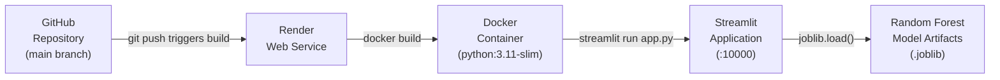

# Satellite Conjunction Risk Screening Dashboard

[](https://render.com)
[](https://www.docker.com)
[](https://streamlit.io)
[](https://www.python.org)
[](https://scikit-learn.org)
[](./tests)

---

A machine learning–assisted web application for screening satellite conjunction events in the **2.0 – 2.9 day** pre-TCA window. The dashboard ingests Conjunction Data Messages (CDMs), validates each record against a strict seven-feature schema, runs dual independent Random Forest pipelines, and surfaces risk classifications, model disagreements, and downloadable reports — all within a clean corporate-grade interface.

---

## Table of Contents

1. [Key Features](#1-key-features)
2. [Machine Learning Models](#2-machine-learning-models)
3. [Canonical Input Features](#3-canonical-input-features)
4. [Validation Rules](#4-validation-rules)
5. [Application Views](#5-application-views)
6. [Repository Structure](#6-repository-structure)
7. [Local Installation](#7-local-installation)
8. [Docker Build and Run](#8-docker-build-and-run)
9. [Render Deployment](#9-render-deployment)
10. [Environment Variables](#10-environment-variables)
11. [Testing](#11-testing)
12. [Troubleshooting](#12-troubleshooting)
13. [Disclaimer](#13-disclaimer)

---

## 1. Key Features

| Capability | Detail |
|---|---|
| **Dual-model inference** | Unweighted RF and SMOTENC-balanced RF evaluated independently |
| **Independent thresholds** | Per-model configurable thresholds (default 0.10 / 0.20) |
| **Strict row preservation** | Rejected records are never silently dropped; included in all exports |
| **Complete validation** | Seven-feature schema, TCA range gating, non-finite checks |
| **Model disagreement detection** | Flags events where model outputs diverge |
| **Downloadable reports** | CSV (full row-level audit) and plain-text executive summary |
| **Professional UI** | Light corporate aesthetic — sidebar navigation, Plotly charts |
| **Containerised deployment** | Single Docker image → Render Web Service, no external dependencies |

---

## 2. Machine Learning Models

Both models are preserved exactly as trained. They are not retrained, replaced, or modified by this application.

| Artifact | Algorithm | Threshold | SHA-256 |
|---|---|---|---|
| `models/rf_unweighted.joblib` | Random Forest (class-weight balanced) | **0.10** | `CE9B055DFC0DAADF439C04ABCEEDA42C859D3443A097E259F962D97B2140CBE1` |
| `models/rf_smotenc_025.joblib` | Random Forest + SMOTENC oversampling | **0.20** | `CBAD36F93B57A1951F4FDA7DB61D1AD2E52FD555CC13453E02074130536C1DA9` |

### Pipeline Stages

Each model artifact is an `imblearn.pipeline.Pipeline` object containing the full preprocessing chain. Inference is performed by calling `.predict_proba()` on the pipeline — no manual imputation, scaling, encoding, or sampling is applied at runtime.

```
Unweighted RF pipeline
  └── preprocess  →  encode  →  classifier (RandomForestClassifier)

SMOTENC RF pipeline
  └── preprocess  →  smotenc  →  encode  →  classifier (RandomForestClassifier)
```

### Classification Rule

```
score >= threshold  →  High Risk  (1)
score <  threshold  →  Low Risk   (0)
```

Each model is evaluated against its own threshold independently. Scores are **not** averaged or combined.

> **Note:** Model scores are relative risk indicators produced by a binary classifier trained on historical CDM data. They are **not** calibrated physical collision probabilities and must not be interpreted as such.

---

## 3. Canonical Input Features

Exactly these seven features must be present in every input record, in any column order. The application reorders them internally before inference.

| # | Feature Name | Type | Valid Range / Values | Physical Description |
|---|---|---|---|---|
| 1 | `time_to_tca` | float | **2.0 – 2.9** (inclusive) | Days until Time of Closest Approach |
| 2 | `max_risk_estimate` | float | Any finite value | Maximum collision risk estimate (log₁₀ scale) |
| 3 | `max_risk_scaling` | float | Any finite value | Scaling factor applied to the risk estimate |
| 4 | `miss_distance` | float | Any finite, non-negative | Predicted closest approach distance (metres) |
| 5 | `mahalanobis_distance` | float | Any finite value | Statistical separation in combined covariance space |
| 6 | `c_obs_used` | float / int | Any finite value | Number of observations used for the chaser object |
| 7 | `c_object_type` | categorical | `DEBRIS`, `PAYLOAD`, `ROCKET BODY`, `TBA`, `UNKNOWN` | Chaser object classification |

**Forbidden fields** — never passed to models: `event_id`, `mission_id`, `risk`, `final_risk`, `final_risk_class`.  
Event identifiers are preserved separately for reporting purposes.

---

## 4. Validation Rules

Every uploaded or manually entered record must pass all six checks before reaching the inference engine.

| Rule | Condition | Rejection Reason |
|---|---|---|
| **Required columns** | All 7 feature columns must be present | Missing column |
| **No missing values** | No `NaN` or `None` in any feature field | Missing value |
| **Numeric finiteness** | All numeric fields must be finite (no `Inf` or `-Inf`) | Non-finite value |
| **TCA range** | `2.0 ≤ time_to_tca ≤ 2.9` | TCA out of range |
| **Categorical validity** | `c_object_type` must be one of the five permitted values | Invalid object type |
| **Non-empty categorical** | `c_object_type` must not be blank or whitespace-only | Empty categorical |

Records that fail any check are included in exports with a clear `REJECTED` status and the specific rejection reason. Their prediction columns are left blank.

---

## 5. Application Views

| Page | Description |
|---|---|
| **Dashboard Overview** | Aggregated metrics: total records, accepted/rejected counts, high/low risk counts, model disagreements, risk distribution chart |
| **Upload CDM Dataset** | Drag-and-drop CSV or XLSX upload, row-level validation table with rejection reasons, accepts only valid rows for inference |
| **Manual Screening** | Seven-field form for single-event entry; real-time dual-model prediction with configurable thresholds |
| **Model Comparison** | Side-by-side table of both model scores, thresholds, classifications, and agreement status for all processed events |
| **Risk Analysis** | Plotly visualisations: risk distribution, model-wise comparison, disagreement breakdown, miss-distance scatter |
| **Reports** | Download full CSV audit report and plain-text executive summary; all rows preserved in output order |
| **About & Methodology** | Model descriptions, feature glossary, validation rules, classification thresholds, and operational disclaimer |

---

## 6. Repository Structure

```
Major_project/
│
├── app.py                        # Streamlit router and session state management
│
├── config/
│   └── settings.py               # Constants: feature list, thresholds, output columns
│
├── core/
│   ├── model_loader.py           # sklearn 1.6 → 1.7 compatibility shim; cached model loading
│   ├── validation_engine.py      # 7-feature schema validation and TCA range gating
│   └── prediction_engine.py      # Dual-model inference and threshold classification
│
├── services/
│   ├── screening_service.py      # Orchestrates validation + inference; 100% row preservation
│   └── export_service.py         # CSV and executive TXT report generation
│
├── components/
│   ├── charts.py                 # Reusable Plotly chart builders
│   ├── tables.py                 # Styled DataFrames and summary tables
│   ├── sidebar.py                # Navigation sidebar and threshold sliders
│   └── styles.py                 # Global CSS injection
│
├── views/
│   ├── view_overview.py          # Dashboard Overview page
│   ├── view_upload.py            # Upload CDM Dataset page
│   ├── view_manual.py            # Manual Screening page
│   ├── view_comparison.py        # Model Comparison page
│   ├── view_analysis.py          # Risk Analysis page
│   ├── view_reports.py           # Reports and Export page
│   └── view_about.py             # About and Methodology page
│
├── models/
│   ├── rf_unweighted.joblib      # Unweighted Random Forest pipeline artifact
│   ├── rf_smotenc_025.joblib     # SMOTENC-balanced Random Forest pipeline artifact
│   └── metadata.json             # Feature list, thresholds, artifact filenames
│
├── data/
│   ├── sample_cdm_valid.csv      # 15 valid CDM records for testing
│   ├── sample_cdm_mixed.csv      # 20 records including rejection scenarios
│   └── sample_cdm_template.csv  # Clean CSV template for data preparation
│
├── tests/
│   ├── test_model_integration.py # Real artifact loading, SHA-256 checksums, live inference
│   ├── test_validation_engine.py # TCA boundaries, missing fields, non-finite values
│   ├── test_screening_service.py # Pipeline execution, row preservation, thresholds
│   ├── test_export_service.py    # CSV and TXT export correctness
│   └── test_docker_and_render.py # Dockerfile syntax, render.yaml, model file sizes
│
├── assets/                       # Static assets (icons, logos)
├── .streamlit/config.toml        # Streamlit server configuration
├── Dockerfile                    # Multi-stage Docker build for Render
├── render.yaml                   # Render Blueprint deployment configuration
├── requirements.txt              # Pinned Python dependencies
├── pytest.ini                    # pytest configuration and warning filters
├── .gitattributes                # LF line-ending normalisation; .joblib marked binary
└── .gitignore
```

---

## 7. Local Installation

**Prerequisites:** Python 3.11, Git

```powershell
# 1. Clone the repository
git clone https://github.com/venkydandi/Space-Collision-Risk-Prediction.git
cd Space-Collision-Risk-Prediction

# 2. Create and activate a virtual environment
python -m venv .venv
.venv\Scripts\Activate.ps1        # PowerShell
# source .venv/bin/activate       # macOS / Linux

# 3. Install pinned dependencies
pip install -r requirements.txt

# 4. Launch the application
streamlit run app.py
```

The application will be available at `http://localhost:8501`.

---

## 8. Docker Build and Run

```bash
# Build the image
docker build -t conjunction-risk-dashboard .

# Run the container (default port 8501)
docker run -p 8501:8501 conjunction-risk-dashboard

# Run on a custom port
docker run -p 10000:10000 -e PORT=10000 conjunction-risk-dashboard
```

Application URL: `http://localhost:8501` (or the port you specified).

---

## 9. Render Deployment

### Deployment Architecture



### Option A — Render Blueprint (Recommended)

The repository includes `render.yaml`. Render will detect it automatically.

1. Go to [dashboard.render.com](https://dashboard.render.com) → **New** → **Blueprint**.
2. Connect your GitHub account and select `Space-Collision-Risk-Prediction`.
3. Render reads `render.yaml` and creates the web service automatically.
4. Click **Apply** — the service builds and deploys.

### Option B — Manual Setup

1. Go to [dashboard.render.com](https://dashboard.render.com) → **New** → **Web Service**.
2. Connect the repository.
3. Set the following:

| Field | Value |
|---|---|
| **Runtime** | Docker |
| **Branch** | `main` |
| **Region** | Oregon (US West) |
| **Plan** | Free (or Starter for production) |
| **Health Check Path** | `/_stcore/health` |

4. Add the environment variable `PORT = 10000`.
5. Click **Create Web Service**.

---

## 10. Environment Variables

| Variable | Default | Description |
|---|---|---|
| `PORT` | `8501` | TCP port Streamlit listens on. Render sets this to `10000`. |
| `PYTHONWARNINGS` | `ignore` | Suppresses benign sklearn version warnings during model loading. |
| `STREAMLIT_SERVER_HEADLESS` | `true` | Disables browser auto-open in containerised environment. |
| `STREAMLIT_SERVER_ENABLE_CORS` | `false` | CORS disabled; Render's proxy handles routing. |
| `STREAMLIT_SERVER_ENABLE_XSRF_PROTECTION` | `true` | CSRF protection enabled. |
| `STREAMLIT_BROWSER_GATHER_USAGE_STATS` | `false` | Telemetry disabled. |

---

## 11. Testing

The test suite contains **24 automated tests** across 5 modules.

```bash
# Run all tests with pytest
pytest tests/ -v

# Run with the built-in unittest runner
python -m unittest discover tests -v
```

**Expected output (summary):**

```
tests/test_docker_and_render.py .....                      [  5 passed ]
tests/test_export_service.py .....                         [  5 passed ]
tests/test_model_integration.py .....                      [  5 passed ]
tests/test_screening_service.py .....                      [  5 passed ]
tests/test_validation_engine.py .....                      [  4 passed ]

======================== 24 passed in ~Xs =========================
```

| Test Module | Coverage |
|---|---|
| `test_model_integration.py` | Real artifact loading, SHA-256 checksums, live inference on sample data |
| `test_validation_engine.py` | TCA boundary conditions, missing columns, non-finite values, invalid categories |
| `test_screening_service.py` | End-to-end pipeline, row preservation, threshold classification |
| `test_export_service.py` | CSV column completeness, row order, TXT report structure |
| `test_docker_and_render.py` | Dockerfile syntax, `render.yaml` schema, model artifact file sizes |

---

## 12. Troubleshooting

**Model fails to load — `AttributeError: _RemainderColsList`**

This is a known pickle incompatibility between scikit-learn 1.6 (training) and 1.7+ (runtime). The application resolves this automatically via a compatibility shim in `core/model_loader.py`. Ensure `scikit-learn==1.6.1` is installed as specified in `requirements.txt`.

---

**Application crashes on startup — `ModuleNotFoundError`**

Run `pip install -r requirements.txt` inside the active virtual environment. Confirm the environment is activated (`(.venv)` prefix in the shell prompt). Do not install packages globally.

---

**Render health check fails — service shows "Unhealthy"**

Verify that `PORT=10000` is set in the Render environment variables. The Dockerfile CMD uses `${PORT:-8501}`, so mismatched port values will cause the health check at `/_stcore/health` to fail. Confirm the health check path is set to `/_stcore/health` in the Render service settings.

---

**Uploaded file is rejected entirely — "No valid records"**

Check that the CSV or XLSX file contains all seven required column headers (exact names, case-sensitive) and that `time_to_tca` values fall within the inclusive range `[2.0, 2.9]`. Download `data/sample_cdm_template.csv` as a formatting reference.

---

## 13. Disclaimer

> **This application is a research and demonstration tool only.**
>
> Risk classifications produced by this dashboard are outputs of binary machine learning classifiers trained on historical Conjunction Data Messages. They are **relative risk indicators** and are **not** calibrated physical collision probabilities. They do not constitute formal conjunction analysis, certified conjunction screening, or operational space traffic management guidance.
>
> This application must not be used as the sole basis for any operational decision concerning a satellite, launch vehicle, or debris object. All conjunction risk assessments for operational purposes must be conducted by qualified astrodynamics personnel using certified tools and authoritative data sources.

---

*Satellite Conjunction Risk Screening Dashboard · Python 3.11 · scikit-learn 1.6.1 · Render Docker Deployment*
